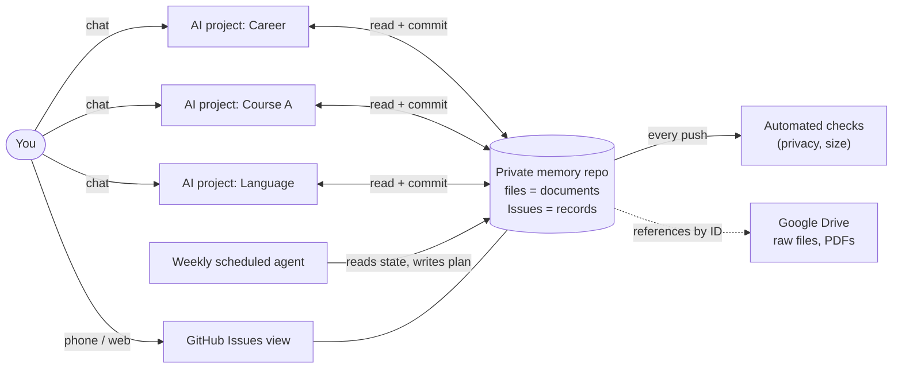

# Career OS

**A simple, AI-agnostic operating system for a student's studies, applications and career —
built on one private GitHub repository.**

  

## The idea in one paragraph

You work with several AI assistants (Claude, ChatGPT, Gemini …) on many things at once: courses,
a seminar, language learning, internship applications. Each chat forgets, each app holds a
fragment, and the same fact ends up in five places. Career OS fixes this with one rule:
**all state lives in one private GitHub repository, and every AI agent reads and writes that
repository directly.** Chats become disposable windows; the repository is the memory.



## Two repositories

| Repository | Visibility | What it holds |
|---|---|---|
| **`career-os`** (this one) | public | The method: architecture, rules template, setup guide, starter templates. No personal data. |
| **`career-memory`** (your own copy) | **private** | Your actual state: one-page context, workspace states, history, evidence, application records. |

`career-os` is the blueprint; `career-memory` is the house built from it.

## Start here

| If you want to … | Read |
|---|---|
| understand how the system is designed and why | [`docs/ARCHITECTURE.md`](docs/ARCHITECTURE.md) |
| set up your own instance from scratch | [`docs/SETUP.md`](docs/SETUP.md) |
| know how everyday things are done (new application, new course, status change …) | [`docs/WORKFLOWS.md`](docs/WORKFLOWS.md) |
| see the exact rules every AI agent follows | [`templates/memory-repo/AGENTS.md`](templates/memory-repo/AGENTS.md) |
| copy the starter files | [`templates/memory-repo/`](templates/memory-repo/) |

## Core rules (summary)

1. **One source of truth.** The private memory repository. An AI's own memory is only a cache.
2. **One home per fact.** Every kind of information has exactly one place (see the table in
   `docs/ARCHITECTURE.md`). Never copy a fact into a second place.
3. **Documents in files, records in Issues.** Things you read (context, course state, notes) are
   Markdown files. Things with a status (applications, leads, deadlines) are GitHub Issues.
4. **State is one page.** Each area has a `CURRENT_STATE.md` of about one page that is rewritten,
   never appended. History goes to `SESSIONS/`.
5. **Save in the same turn, visibly.** When you report something, the agent commits it immediately
   and ends its reply with a receipt line. No receipt = nothing was saved.
6. **Only direct writers write.** An AI that cannot commit to the repository itself is read-only.
   You never copy-paste state between tools.
7. **Automation must be visible.** Anything that runs on its own produces something you see, or it is removed.
8. **Real work first.** System changes only when a real task is blocked; other ideas go to a backlog.

## Repository map

```
career-os/
├─ README.md            ← you are here
├─ docs/
│  ├─ ARCHITECTURE.md   ← design, layers, where each fact lives, lessons from v1
│  ├─ SETUP.md          ← build your own instance step by step
│  ├─ WORKFLOWS.md      ← everyday procedures
│  ├─ specs/            ← reusable specifications (e.g. course Master Notes)
│  └─ legacy/           ← v1 documentation (frozen, reference only)
├─ templates/
│  ├─ memory-repo/      ← starter files for your private repository
│  └─ legacy/           ← v1 templates
├─ AGENTS.md            ← rules for AI agents editing THIS public repository
└─ apps/ packages/ scripts/ tests/ config/ examples/   ← v1 engine code (frozen, see below)
```

## Status

- **v2 (current, October 2026):** the method described above. It needs only a GitHub account,
  an AI assistant that can work with GitHub, and optionally Google Drive.
- **v1 (frozen):** an earlier, much larger design — a Google Apps Script ingestion runtime, a
  knowledge compiler, a job-feed engine and many protocols. Its code remains here as a
  reference and portfolio artifact; it is not developed further and v2 does not depend on it.
  Documentation: [`docs/legacy/`](docs/legacy/). The reasons for the redesign are in
  `docs/ARCHITECTURE.md` ("Lessons from v1").

Privacy policy for this public repository: [`PRIVACY.md`](PRIVACY.md).
