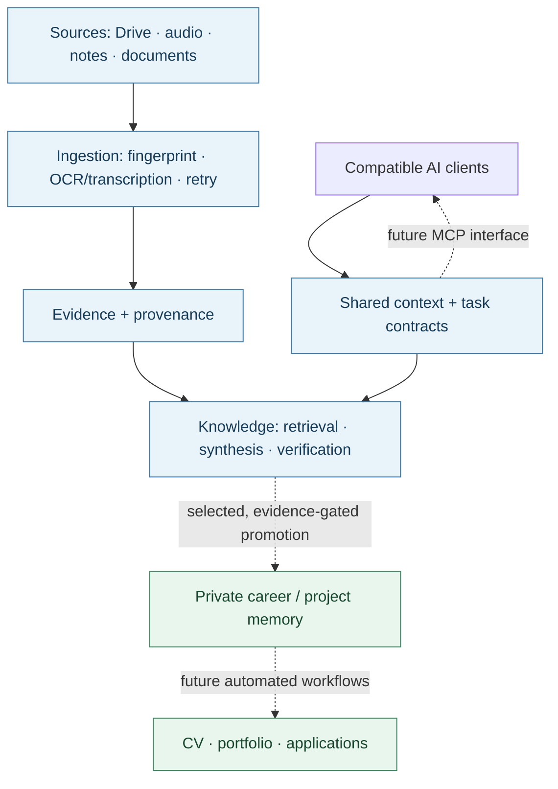
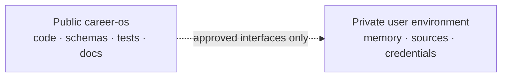

# Career OS

**A privacy-first, AI-assisted academic-to-career knowledge and workflow framework.**


> **Built first for Master's and PhD students** who manage coursework, research, technical projects, AI assistants, and early-career preparation across disconnected tools. Designed to evolve into a reusable system for other users and disciplines.

## Why Career OS?

AI conversations lose continuity across clients. Lecture materials, project results, skill evidence, CVs, and applications live in separate places. Recreating context and updating everything manually wastes time—and can introduce inconsistent or unsupported claims.

**Career OS aims to connect learning, evidence, and career progress through one persistent, privacy-conscious framework**, while keeping AI providers and storage systems replaceable.

## How it fits together



**Solid arrows** show existing architectural/component pathways; **dashed arrows** mark selective, partial, or planned integration—not a claim of production-complete automation.

### Two connected pillars

| Shared AI context | Evidence-to-knowledge |
|---|---|
| Provider-neutral interaction events, active tasks, state and bounded context bundles. | Source/version identity, duplicate-safe processing, provenance, retrieval, structured synthesis and uncertainty tracking. |
| **Goal:** continue work without replaying every chat. | **Goal:** turn learning and project materials into reusable, evidence-backed knowledge. |

A concrete academic workflow is **Master Notes**: align lecture transcripts, handwritten notes, diagrams and other sources; check scientific claims and coverage; review before approval. The [execution specification](docs/MASTER_NOTES_CANONICAL_SPECIFICATION_v1.md) exists, but fully autonomous production-quality generation is **not** claimed.

## What is implemented?

| Capability | Current status | Inspect |
|---|---|---|
| Drive change scanning, image OCR, audio/transcription integrations, fingerprinting, queue/retry logic | **Working paths**, provider/quota-dependent | [Apps Script runtime](apps/apps-script-runtime/) |
| Shared AI context and task contracts | **Partial** — client adapters remain | [Core contracts](packages/core/src/shared-context.mjs) |
| Evidence retrieval, session synthesis, cross-session consolidation | **Implemented components; partial production integration** | [Knowledge package](packages/knowledge/) |
| Gemini, Groq and institutional text-provider integration patterns | **Implemented in project scope** | [Runtime](apps/apps-script-runtime/) |
| Privacy checks, synthetic tests and CI | **Working** | [Tests](tests/) · [Privacy](PRIVACY.md) |

See the [detailed, evidence-based capability matrix](docs/IMPLEMENTATION_STATUS.md). The public repository contains reusable code, contracts, tests and synthetic examples—not personal memory, credentials, private documents or live user data.

## Where it is going

Career OS is an **iteratively improving engineering project**, not a finished autonomous SaaS product. The next product directions are:

- **Interoperability:** a standard interface such as MCP so compatible AI clients can use shared context and tools.
- **Independent execution:** durable jobs and event-driven workflows that do not depend on an open AI chat.
- **Academic-to-career continuity:** reviewable, evidence-gated CV and portfolio updates.
- **Portability:** clearer onboarding and reproducible setup for students using their *own* accounts and storage.

**Cost principle:** prioritize **zero additional recurring spend** by reusing existing services, permitted free quotas and free-to-use tooling. Provider limits, credentials and optional paid infrastructure remain deployment-specific; unrestricted free cloud operation is not guaranteed.

## Try the public demo

Requires **Node.js 20+**. No private data or credentials are needed for the synthetic demo and public tests.

```bash
npm test
npm run demo:knowledge
npm run check:privacy
```

The demo illustrates deduplication, cross-session concept consolidation, evidence references, source-version lineage and preserved uncertainty. It is **not** a complete multi-user deployment.

## Privacy and ownership



**One canonical owner per durable fact.** Chats and AI agents are execution surfaces, not sources of truth. Raw evidence and AI inference remain distinct; external publishing and applications require explicit user approval.

## Documentation

- **Start here:** [Installation and host binding](docs/INSTALLATION.md) · [Architecture](docs/ARCHITECTURE.md)
- **For compatible agents:** [Session bootstrap](docs/SESSION_BOOTSTRAP.md) · [Routing](docs/ROUTING_PROTOCOL.md) · [Session harvest](docs/SESSION_HARVEST_PROTOCOL.md)
- **Engineering and governance:** [Implementation status](docs/IMPLEMENTATION_STATUS.md) · [Shared agent context](docs/SHARED_AGENT_CONTEXT.md) · [Governance](docs/GOVERNANCE.md) · [Privacy](PRIVACY.md)

**Project status:** **v0.1, portfolio-ready foundations; ongoing development.** Features described as partial or planned should not be presented as fully operational. Development favors measurable usefulness, privacy, reliability and reuse over adding infrastructure for its own sake.
