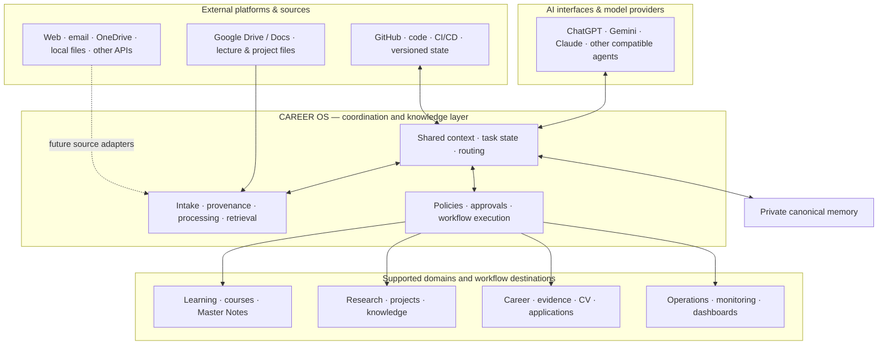
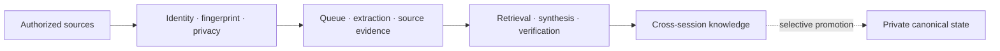
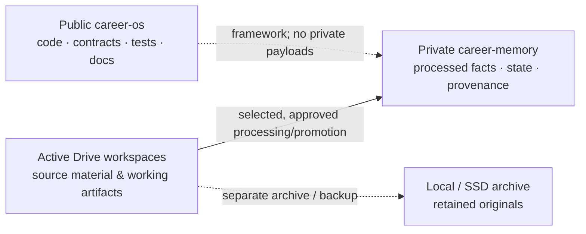

# Career OS

**Privacy-first infrastructure for shared AI context, connected knowledge, and cross-platform workflows.**


> **Starting with Master's and PhD students; designed for broader reuse.** Career OS connects AI assistants, cloud tools, repositories, knowledge, project work, and professional activities without making any single chat, app, or provider the system of record.

## The problem

A student or researcher might use **ChatGPT for reasoning, Gemini for analysis, Google Drive for lecture/research material, GitHub for projects, and a website or other tools for publishing and tracking work**. Each platform holds a different fragment of the work. Switching AI clients can lose context; sources are processed repeatedly; decisions, task status, and evidence become scattered.

**Career OS is the coordination layer between these systems**—not a new chatbot, not just a CV builder, and not a replacement for Google Drive or GitHub. Its goal is durable continuity, traceable knowledge, and reusable workflows spanning academic, research, technical, and career activities.

## The connected ecosystem



**This is the system boundary and integration vision, not a claim that every arrow is already a production integration.** Drive ingestion, GitHub-backed framework/memory, AI-provider integration paths, and selected task/processing components exist. Universal AI-client adapters, additional app connectors, and independent end-to-end orchestration are still in development. See [implementation status](docs/IMPLEMENTATION_STATUS.md).

### What connects to what?

| Layer | Systems / examples | Role and maturity |
|---|---|---|
| **AI interfaces** | ChatGPT, Gemini, Claude, future agents | AI does the reasoning; shared-context contracts exist; cross-client interoperability is **partial**. |
| **Active workspace & sources** | Google Drive, Docs, audio, images, transcripts, notes | Drive-adjacent scanner, selected OCR/audio paths, fingerprinting and queues **work**; broader document support is **planned**. |
| **Engineering & durable state** | GitHub repositories, Actions, private `career-memory` | Public reusable code/CI plus separate private processed-state backend; promotion across clients is **partial**. |
| **Additional integrations** | Email, websites, OneDrive, Dropbox, local sources and APIs | **Adapter targets**, not universal live connectors. |
| **Domain workflows** | Studying, research, project coordination, skills evidence, career documents, monitoring | Reusable contracts with **different levels of implementation**; not one fixed CV pipeline. |

The architecture is **ports-and-adapters**: a provider can be changed without redefining source identity, canonical ownership, provenance, or task state. AI clients are executors; chats do not own durable truth.

## Two foundational capabilities

### 1. Shared AI context

Provider-neutral contracts model interaction references, task status, priorities, active work, and bounded context handoffs. A compatible agent should retrieve **only the context relevant to its task**, rather than re-reading entire conversations or inventing a second memory store.

- [Core shared-context implementation](packages/core/src/shared-context.mjs)
- [Shared-agent context design](docs/SHARED_AGENT_CONTEXT.md)

### 2. Evidence → knowledge



This pipeline prioritizes **source/version lineage, deduplication, uncertainty, conflict preservation, verification status, and separation of evidence from inference**. Existing preprocessing paths and reusable compiler/retrieval/consolidation components do **not** mean full production synthesis is automatically triggered.

One concrete academic use case is **Master Notes**: reconcile lecture transcripts, handwritten formulas, diagrams and supporting material into a verified, reviewable course script. The [canonical execution specification](docs/MASTER_NOTES_CANONICAL_SPECIFICATION_v1.md) is available; a fully autonomous production-quality document generator is **not** claimed.

## Inspectable implementation

| Capability | Evidence | Status |
|---|---|---|
| Change detection, queue/retry, deduplication, image OCR and audio/transcription paths | [Apps Script runtime](apps/apps-script-runtime/) | **Working paths**, provider/quota-dependent |
| Shared context, task ledger and routing contracts | [Core](packages/core/src/shared-context.mjs) · [Tests](tests/) | **Implemented contracts / partial adapters** |
| Metadata/lexical retrieval, synthesis and cross-session consolidation | [Knowledge package](packages/knowledge/) · [Synthetic demo](examples/synthetic-knowledge/) | **Implemented components / partial production integration** |
| Gemini, Groq and university text-provider integration patterns | [Runtime](apps/apps-script-runtime/) | **Implemented in project scope** |
| Privacy checks, CI and public synthetic tests | [Scripts](scripts/) · [Tests](tests/) | **Working** |

**Not production-complete:** a universal MCP server for every AI client, turnkey multi-user onboarding, a production vector/RAG database, fully automated Master Notes, or autonomous end-to-end sync across all connected apps. Refer to the [full capability matrix](docs/IMPLEMENTATION_STATUS.md) for exact boundaries.

## Try it and explore

Requires **Node.js 20+**. The public synthetic demo and tests need no private credentials:

```bash
npm test
npm run demo:knowledge
npm run check:privacy
```

The demo illustrates cross-session consolidation, source-version lineage, deduplication and preserved uncertainty; it is **not** a deployable full multi-user instance.

**Current execution:** Google Apps Script performs selected cloud-side Drive ingestion and processing. Node.js packages, tests, and GitHub Actions support the reusable implementation. See the [runtime architecture](docs/ARCHITECTURE.md).

## Ownership, privacy and cost



**One canonical owner per durable fact.** Raw originals, processed knowledge, working files, and public code have separate authorities. Credentials, private content, contact data and live personal state never belong in the public framework. Automated GitHub → Drive synchronization is **not** the storage model; sending, submitting and publishing require explicit approval.

**Cost direction:** prefer **zero additional recurring spend** using existing services, free/open-source tools and permitted quotas. Availability and limits vary; unrestricted free API/cloud operation is not guaranteed.

## Ongoing development

Career OS is a **portfolio-ready v0.1 engineering framework under continuous improvement**. Its next product goals are interoperable AI-client access (e.g., MCP), durable workflow execution outside chat sessions, additional authorized connectors, reproducible onboarding, and measurable reliability/time savings—without treating roadmap items as shipped features.

**Read more:** [Architecture](docs/ARCHITECTURE.md) · [Installation](docs/INSTALLATION.md) · [Implementation status](docs/IMPLEMENTATION_STATUS.md) · [Workflow registry](docs/WORKFLOW_REGISTRY.md) · [Session bootstrap](docs/SESSION_BOOTSTRAP.md) · [Session harvest](docs/SESSION_HARVEST_PROTOCOL.md) · [Privacy](PRIVACY.md) · [Governance](docs/GOVERNANCE.md).
